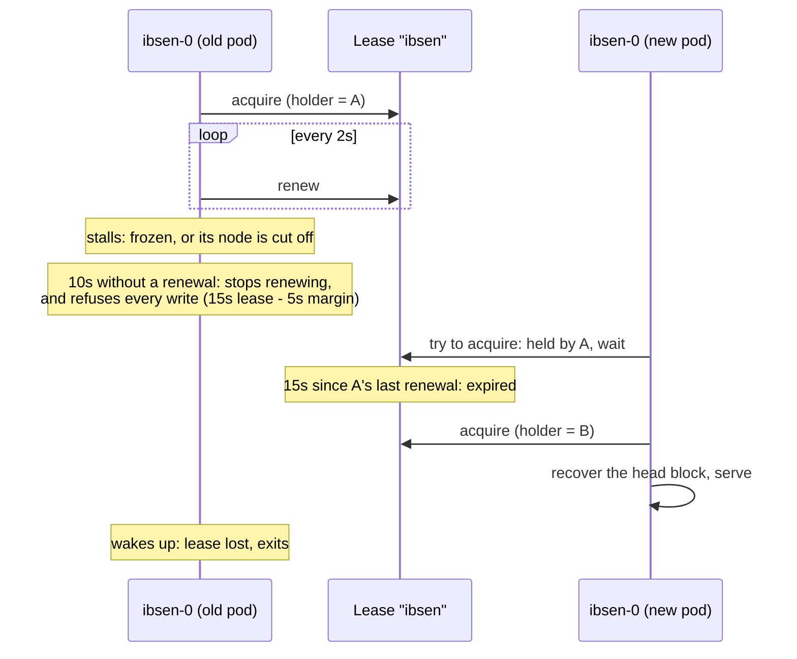

# Operations guide

This guide is for people **running** Ibsen: how to configure it, what it promises about your
data, what compression costs, and how to put it in a container, behind TLS, or under a
profiler. [USER_GUIDE.md](USER_GUIDE.md) is for people using the log. The reasoning behind
every promise here is in [ARCHITECTURE.md](../ARCHITECTURE.md).

- [Configuration](#configuration)
- [Durability](#durability)
- [Retention](#retention)
- [Compression](#compression)
- [Read-only mode](#read-only-mode)
- [One writer per directory](#one-writer-per-directory)
- [Choosing a lock](#choosing-a-lock)
- [Running on Kubernetes](#running-on-kubernetes)
- [Docker](#docker)
- [TLS](#tls)
- [OpenTelemetry](#opentelemetry)
- [Profiling](#profiling)
- [Benchmarking](#benchmarking)
- [gRPC troubleshooting](#grpc-troubleshooting)
- [Development](#development)

---

## Configuration

Every server flag has an environment variable, so containers need no command line.

| flag | env | default | what it does |
|---|---|---|---|
| `-d, --rootDirectory` | `IBSEN_ROOT_DIRECTORY` | *(unset)* | where the log is kept; unset means in memory |
| `-l, --host` / `-p, --port` | `IBSEN_HOST` / `IBSEN_PORT` | `0.0.0.0` / `54321` | gRPC listener |
| `-m, --maxBlockSize` | `IBSEN_MAX_BLOCK_SIZE` | `1000` | MB per block before rolling over |
| `--flushMode` | `IBSEN_FLUSH_MODE` | `lenient` | when a write is acknowledged: `lenient` or `strict`; see [Durability](#durability) |
| `--flushIntervalMs` | `IBSEN_FLUSH_INTERVAL_MS` | `1000` | lenient: milliseconds between fsyncs, at least 1. Strict: how long a batch may wait for company, `0` never waits |
| `-f, --flushEntries` | `IBSEN_FLUSH_ENTRIES` | `1` | strict only: entries that may wait for a flush before `--flushIntervalMs` is up; on its own it does nothing |
| `-i, --indexSparsity` | `IBSEN_INDEX_SPARSITY` | `10` | entries between index pairs |
| `--maxFrameEntries` | `IBSEN_MAX_FRAME_ENTRIES` | `1000` | entries that may share a frame |
| `--maxFrameBytes` | `IBSEN_MAX_FRAME_BYTES` | `1 MiB` | entry bytes that may share a frame, before compression |
| `--compression` | `IBSEN_COMPRESSION` | `zstd` | codec for new frames: `zstd` or `none` |
| `--compressionLevel` | `IBSEN_COMPRESSION_LEVEL` | `default` | `fastest`, `default`, `better`, `best` |
| `--compressMinBytes` | `IBSEN_COMPRESS_MIN_BYTES` | `128` | frames smaller than this are stored without trying to compress them; `0` tries every frame |
| `--adaptiveCompression` | `IBSEN_ADAPTIVE_COMPRESSION` | `true` | stop trying to compress a topic whose last 16 frames did not shrink, and try again every 64th |
| `--compressionDict` | `IBSEN_COMPRESSION_DICT` | `auto` | train a zstd dictionary per topic (`auto`) or not (`off`); see [Dictionaries](#dictionaries) |
| `--dictTrainBytes` | `IBSEN_DICT_TRAIN_BYTES` | `4MiB` | entry bytes a topic writes before its first dictionary is trained |
| `-o, --readOnly` | `IBSEN_READ_ONLY` | `false` | serve a directory without changing a byte of it |
| `--producerWindowBlocks` | `IBSEN_PRODUCER_WINDOW_BLOCKS` | `4` | [safe retries](USER_GUIDE.md#safe-retries): how many of a topic's newest blocks a producer is remembered across |
| `--retainAge` | `IBSEN_RETAIN_AGE` | *(unset)* | delete whole blocks older than this, such as `168h` or `7d`; see [Retention](#retention) |
| `--retainBytes` | `IBSEN_RETAIN_BYTES` | *(unset)* | keep each topic to about this size, such as `10GB` or `512MiB` |
| `--config` | `IBSEN_CONFIG` | `<rootDirectory>/ibsen.json` | settings file with per-topic overrides |
| `--lock` | `IBSEN_LOCK` | `auto` | single-writer lock: `auto`, `flock`, `file` or `none`; see [Choosing a lock](#choosing-a-lock) |
| `-e, --OTELExporter` | | | OpenTelemetry collector address, e.g. `0.0.0.0:4317` |
| `--certKey` / `--privateKey` | | | TLS for gRPC |
| `-z` / `-y` | | | write a CPU / memory profile |
| `-v, --debug` / `-t, --trace` | | | log level |

An unknown `--compression` name is refused at startup rather than quietly falling back to
none, because falling back writes a log the operator did not ask for.

The filter commands (`append`, `cat`, `topics`) and their own flags are described in the
[user guide](USER_GUIDE.md#the-filter-commands-flags).

## Durability

Ibsen has two flush modes. Both keep the promise that matters most to readers: **no reader
ever sees an entry that a power cut could take back**. They differ in when a *writer* is told
its write is saved.

- **Lenient (the default) is fast.** A write is acknowledged as soon as it is in the operating
  system's page cache, and Ibsen fsyncs about once a second. If the Ibsen process crashes,
  nothing is lost: the operating system still has the data. If the machine loses power, or
  the kernel crashes, writes acknowledged since the last fsync can be lost.
- **Strict waits for the disk.** A write is acknowledged only once the fsync covering it has
  returned, so nothing that was acknowledged can be lost, even to a power cut. Concurrent
  writers share fsyncs, but each write still waits for one.

| | `lenient` (default) | `strict` |
|---|---|---|
| writer acknowledged | once the append is in the page cache | once the fsync covering it returns |
| entry readable | after the next fsync | after the fsync covering it |
| fsync | every `--flushIntervalMs` (default 1000), and on a clean exit | per write, shared by writers arriving together |
| Ibsen process crash | nothing lost | nothing lost |
| power cut or kernel crash | acknowledged writes since the last fsync can be lost | nothing acknowledged is lost |

**Pick strict** (`--flushMode strict`, or `IBSEN_FLUSH_MODE=strict`) when losing up to a
second of acknowledged writes after a power cut is unacceptable: payments, orders, anything a
client will not send again because it was told the write succeeded. Lenient is the right
default for events, metrics and logs, where the source can be replayed or a second's loss in a
power cut is tolerable.

In both modes a clean shutdown of the server, and the end of an `ibsen append`, flushes
everything first: **`append` exits zero only once everything it wrote is on durable media**,
so a pipeline that finished means durable either way. A store that cannot sync, like
`memstore`, pays none of this: its entries are durable, and readable, the moment the append
returns.

What it costs and buys, appending 30,000 JSON lines one per write (`--batchSize 1`) to ext4 on
a virtio disk, and reading back one entry written alone (the time from the write being sent to
a reader seeing it):

| | `lenient` | `strict` |
|---|---|---|
| 30,000 one-entry writes | **0.37 s** | 5.4 s |
| 30,000 entries, 10 per write | 0.12 s | 0.65 s |
| 300,000 entries, default `--batchSize` | 0.18 s | 0.19 s |
| one write acknowledged (median) | 0.10 ms | 0.65 ms |
| one entry readable (median / max) | 0.95 s / 1.00 s | 0.75 ms / 3.7 ms |

So lenient is what makes small writes fast — fourteen times here, more on slower disks — and a
large batch costs the same either way, because one fsync per ten thousand entries is nothing.
The price is the reader's: in lenient mode an entry becomes readable at the next tick, so a
tailing reader runs up to `--flushIntervalMs` behind the writer. Lower it to shorten the lag
at the cost of more fsyncs.

### Strict mode's flush policy

In strict mode the two flush flags work as a pair, and raising `--flushEntries` on its own
changes nothing: with `--flushIntervalMs 0` a batch is never held back, so every write is
flushed at once whatever the entry count says. (The default interval of 1000 is held back only
while fewer than `--flushEntries` entries are waiting, and with the default of 1 that is never.)
Set an interval and a larger count and the count becomes the escape from it — "enough have
arrived, do not wait out the rest" — and what you are buying is writers whose entries wait
together, at the cost of the latency of the ones that arrive early. There is no background
flusher goroutine in strict mode: the writer that needs its entries durable drives the sync,
and writers whose entries joined the same batch wait on the same one.

### `--batchSize` is the dial for `append`

In strict mode the flush policy does nothing for `append`, because a stream is a single writer
and there is nobody else's batch for its entries to join: holding one back only makes it wait.
**`--batchSize` is the dial there.** One write is one append and one flush, so appending 126,574 lines costs 14
fsyncs at the default 10000 and 128 at `--batchSize 1000`, while `--flushEntries 10000` costs
the same as not passing it at all. A 400 MB stream of 12.6M lines took 11–22s at the default
against 55–86s at 1000, three runs each on an ordinary disk. Nothing about durability changes
with the batch size: every `append` that exits zero has its entries on durable media, and a
batch that fails takes with it only entries no one was told about.

The size is a ceiling and not a quota. A batch is written when it is full, when it holds 16 MiB
of entries — the size counts entries, and entries have no size — **or when the stream has
nothing more ready**. So `tail -F applog | ibsen append` makes each line durable as it arrives
without being told to, and the same default still reads a file at one sync per 10000 lines: a
bulk load keeps the reader's buffer full, so its batches fill before they run dry. Appending
400 MB of 12.6M lines costs 1272 fsyncs against the 1264 the batch size alone asks for.

### A failed fsync stops the topic

In strict mode the writes waiting on it get the error. In lenient mode those writes were
already acknowledged, so the failure is logged at error level with the range of offsets it
covered, and the next write, flush or shutdown of that topic reports it. In both, every later
write to that topic is refused until the process is restarted, nothing past the last
successful fsync ever becomes readable, and other topics carry on. It is not retried, because on Linux a retry
succeeds without writing what the failed one dropped, and the next write would be acknowledged
behind a hole. On restart the head block is read from the disk rather than the page cache (on
Linux), so recovery sees the hole and cuts there. A failing fsync usually means failing
storage: look at the disk before you restart.

## Retention

Without retention a log keeps everything, forever. Retention deletes a topic's oldest data in
whole blocks — the files a topic is stored in, each up to `--maxBlockSize` — once it passes an
age, a size, or both:

```shell
ibsen server -d /srv/ibsen --retainAge 7d          # keep a week
ibsen server -d /srv/ibsen --retainBytes 10GB      # keep about 10 GB per topic
ibsen server -d /srv/ibsen --retainAge 30d --retainBytes 50GB   # whichever comes first
```

- **Whole blocks, oldest first.** A block goes once its newest entry is older than
  `--retainAge`, or while the topic holds more than `--retainBytes`. So a topic holds a little
  more than the limit says — up to one block more — and never less than its newest block,
  which is **never deleted**, even when it alone is over the limit.
- **When.** A server checks every minute. `ibsen append` applies it once, when it finishes.
  `ibsen cat` and a `--readOnly` server never delete anything.
- **Sizes** are `10GB`, `500MB` (powers of 1000) or `512MiB`, `2GiB` (powers of 1024), or a
  plain number of bytes. **Ages** are `168h`, `90m` or `7d`. Unset, or `0`, is no limit.

### Per-topic settings

Put an `ibsen.json` in the data directory, so the settings travel with the data and the
server and `ibsen append` read the same file. `--config` (or `IBSEN_CONFIG`) points
elsewhere, for example at a mounted Kubernetes ConfigMap:

```json
{
  "topics": {
    "audit":   { "retainAge": "720h" },
    "metrics": { "retainBytes": "50GB" }
  }
}
```

A topic listed here gets exactly what its entry says, **instead of** the global flags: above,
`audit` keeps thirty days however large it grows, and `metrics` keeps 50 GB however old.
Topics not listed get the flags. Unknown keys and values that do not parse stop Ibsen at
startup with a message saying which, rather than being ignored. Ibsen only ever reads the
file.

### What a reader sees

A reader asking for an offset that has been deleted gets an error naming the earliest offset
still there — `OUT_OF_RANGE` over gRPC, and from `ibsen cat`:

```
ibsen: offset 0 is no longer retained; the earliest available is 290000, which --fromEarliest starts from
```

`ibsen cat topic` with no offset starts at the earliest retained entry by itself. With an
offset, `--fromEarliest` (or `fromEarliest` in the gRPC read) starts at the earliest when the
one asked for is gone. A reader that is following the log and falls so far behind that the
block it needs next is deleted is told the same thing, rather than skipped ahead, so it knows
it missed something. [The user guide](USER_GUIDE.md#starting-from-the-earliest-offset) has the
reader's side.

## Compression

**zstd by default.** A log is mostly text that repeats — the same field names, the same hosts,
the same shapes of message, entry after entry — so the bytes are worth compressing and the
choice is between disk and CPU rather than between features.

A setting only decides what is *written*. Every codec the binary links stays in the read
registry, so turning compression on, off or over never strands a block written under the old
setting; a frame carries one byte naming the codec that wrote it, which is also why one block
can hold frames of several codecs and why changing the setting rewrites nothing. Compression
that did not pay is thrown away per frame, so a frame a codec cannot shrink is stored plain
and a small write is never made larger.

What it costs and buys, appending 1.1 GB of wiki XML (21.7M lines) and reading it back, on an
ordinary ext4 disk with the page cache warm:

| | `--compression none` | `zstd` (default) |
|---|---|---|
| log on disk | 1.41 GiB | **456 MiB** |
| append, CPU | 10.7 s | 18.8 s |
| `cat > /dev/null` | 4.5–5.0 s | 6.2–6.9 s |

So it is a third of the disk for about three quarters more write CPU, and reads that are
slower when the bytes were already in memory and faster when they have to come off slower
storage than this. Two cases want `--compression none`: entries that are already compressed —
on incompressible payloads zstd measured 72 MB/s against 315 MB/s through the codec, for 10%
— and readers that seek rather than stream, since a frame is decoded whole and a single-entry
read at the default frame bound decodes 137 KB in 213 µs against 98 µs plain.

### Not paying for compression that does not pay

Ibsen keeps a frame's compressed form only when it is smaller, but the attempt costs CPU
either way: five to fifteen times the cost of storing the bytes as they are. Two settings skip
the attempt where it is unlikely to pay, and neither changes what is on disk or what a reader
needs:

- `--compressMinBytes` (128): a frame smaller than this is stored without trying. Below about
  128 bytes zstd almost never shrinks anything. With a dictionary the topic uses three eighths
  of it, since a dictionary pays on frames from about 48 bytes.
- `--adaptiveCompression` (on): a topic whose last 16 frames did not shrink stops trying, and
  tries every 64th frame in case its data changed. This is for entries that are already
  compressed or encrypted.

Measured on one-entry writes, this cut write time by a third to a half on both JSON and random
entries, with the same bytes on disk; where compression pays, nothing changes. `--compressMinBytes 0
--adaptiveCompression=false` tries every frame, as earlier versions did.

### Dictionaries

zstd compresses each frame on its own, and a frame is one write — so a client that writes one
small event at a time gives it almost nothing to work with. A 130-byte JSON event usually
comes back *larger* from zstd, and is stored as it was.

A **dictionary** fixes that. After a topic has written a few megabytes (`--dictTrainBytes`,
4 MiB), Ibsen takes a sample of its entries and has zstd learn what they have in common: the
field names, the hosts, the shapes of message. The result is a small dictionary, a few
kilobytes, saved next to the topic as `<id>.dict`. New frames are compressed with it, and each
frame records which dictionary it used. If the data changes and compression gets noticeably
worse, Ibsen trains a new one; old dictionaries stay as long as any frame still needs them.
Nothing waits for training: it runs beside the writes, which carry on without a dictionary
until one is ready.

It is on by default with zstd (`--compressionDict auto`), and costs nothing where it does not
help: a dictionary is kept only if it makes held-out entries at least 10% smaller at the size
the topic's frames actually are. Large frames — a client that batches hundreds of entries per
write — compress well without one, and none is kept.

On ~130-byte JSON events, through a real topic:

| entries per write | zstd | zstd + dictionary | write CPU per entry |
|---|---|---|---|
| 1 | 1.26 of the input (stored plain) | **0.80** | 1.9 → 12.4 µs |
| 10 | 0.30 | **0.26** | 1.9 → 3.5 µs |
| 100 | 0.17 | 0.17 (no dictionary kept) | unchanged |

Appending 30000 real one-line JSON events one per write took 3.7 MB with a dictionary and 5.1
MB without. **When to turn it off** (`--compressionDict off`): when write CPU matters more than
disk for a topic of small writes. Frames written with a dictionary stay readable either way,
as long as the `.dict` files are kept with the data — they are part of the log, so back them
up with it. A frame whose dictionary is missing is reported by name when it is read; nothing
is deleted.

## Read-only mode

`--readOnly` builds a store that refuses every call that would change a file — not merely a
manager that turns writes away. This matters more than it looks: loading a topic recovers its
head block, truncates a torn tail and rebuilds its index. Pointed at a directory another
instance owns, a read-only server without a read-only store would quietly rewrite it.

`ibsen cat` and `ibsen topics` are always built this way, which is why they can be pointed at
a directory a server is writing without taking a lock or changing a byte.

## One writer per directory

**Ibsen does not implement replication, consensus or distributed locking, and that is the
design, not a gap.**

Raft, Paxos and their friends are not hard to write badly and very hard to write well.
Operating them is harder still, and every log that has grown its own has spent years on it.
The world already has systems whose entire job is to agree on things, and infrastructure
whose entire job is to keep bytes alive on more than one machine. Ibsen's position is that a
log should use them rather than reimplement them:

- **Replication belongs to storage.** Run Ibsen as a Kubernetes StatefulSet on a replicated
  volume, or on whatever your platform already replicates. Those systems are maintained by
  people whose job it is, and they were being hardened long before your log existed.
- **Fencing belongs to whatever already holds elections.** If you need a distributed
  single-writer guarantee, etcd, Kubernetes leases or your cloud's lock service already give
  you one. Ibsen is built so that it becomes a thin storage decorator at wiring time — no
  change to the core, no change to any port.
- **What Ibsen ships itself is a backstop, not a cluster.** A lock at `<root>/.writeLock`
  keeps a second server from writing the same directory. On a local filesystem it is a kernel
  lock, which has no weak spots worth naming; see [Choosing a lock](#choosing-a-lock). Where
  that is not guaranteed it is a lease file, which is honest about its limits: claiming a free lock is `O_CREATE|O_EXCL`, which a real filesystem makes
  atomic; taking over an expired one is confirmed by re-reading rather than assumed, because
  a filesystem has no compare-and-swap. Renewal proves the lease is still its own before
  extending it, and the moment it cannot, the process stops writing — it does **not** shut
  down cleanly, because a clean shutdown flushes, and flushing is exactly what a writer that
  may have lost its lease must not do.
- **Embedded pays nothing for any of this.** The coordination port has a no-op adapter, so a
  single-process or microcontroller build carries no locking code at all.

The honest version of the trade: Ibsen gives you a very good single-writer log and expects
your platform to provide durability across machines. If you need multi-master writes with
automatic failover and no external system, Ibsen is the wrong tool and Kafka is waiting for
you. The full reasoning is in [ARCHITECTURE.md §16](../ARCHITECTURE.md#16-single-writer-and-distribution).

## Choosing a lock

Two programs writing one log at the same time would corrupt it, so a writer — `ibsen server`
or `ibsen append` — takes a lock on the data directory first, and a second writer is refused.
Readers (`ibsen cat`, `ibsen topics`, `--readOnly`) take nothing. `--lock` (or `IBSEN_LOCK`)
says which lock:

| `--lock` | what it is | use it when |
|---|---|---|
| `auto` (default) | a kernel lock where one is guaranteed, the lease file everywhere else; it logs which and why | almost always |
| `flock` | a kernel lock (`flock(2)`), or refuse to start, naming the reason | you want to be told rather than fall back: a data directory that must be on local disk |
| `file` | the lease file: a file renewed every few seconds, taken over by another instance once it stops being renewed | a directory several machines can see, such as a network filesystem; or matching older Ibsen versions on the same directory |
| `none` | nothing | one process will ever open the directory, and you would rather not pay for a lock |
| `k8s` | a Kubernetes Lease object, renewed every few seconds; only in the `ibsen-k8s` binary | running on Kubernetes, where the data directory is a volume that can move between machines; see [Running on Kubernetes](#running-on-kubernetes) |

**Why the kernel lock is safer.** The kernel holds it for exactly as long as the process lives.
A process that freezes for a minute still holds it, so nobody takes over while it is stalled,
and a process that crashes lets go of it at that instant. The lease file has to be renewed, and
a process that stalls past its lease can briefly overlap with the one that took over; it
notices on its next renewal and exits, but it cannot make the overlap zero.

**When the kernel lock is guaranteed.** On Linux, macOS and the BSDs, on a local filesystem —
ext4, xfs, btrfs, tmpfs, zfs, overlayfs, apfs, hfs or ufs — and only once a self-test has
confirmed the filesystem really enforces it. **Network filesystems are refused** (NFS,
SMB/CIFS, CephFS, GlusterFS and other FUSE filesystems, and the like): a lock there may hold on
one machine and be invisible to another, which is the very case a lock exists for. Windows has
no `flock`, so `auto` uses the lease file there.

**Containers.** Two containers on one host sharing a `hostPath` or local volume share one
kernel, so the kernel lock works between them. Across machines it does not — that is what the
volume's own single-node attachment is for on Kubernetes.

**Mixed versions.** The kernel lock and the lease file see each other, but an Ibsen from before
the kernel lock knows only the lease file and would read a kernel-locked directory as free
after ten seconds. Run the same version on every instance that can reach one directory.

## Running on Kubernetes

Ibsen runs on Kubernetes as a **StatefulSet with one replica**, on a block-storage volume
(EBS, Persistent Disk, Azure Disk, Ceph RBD, …). The volume keeps the data; Kubernetes moves
the pod and its volume to another machine when one fails. Use the **`ibsen-k8s`** binary and
image: it is `ibsen` with one more lock, `--lock k8s`, which keeps the single-writer lock in a
Kubernetes **Lease**. (It is a separate binary because the Kubernetes client is large: 41 MB
against 17 MB.)

### Why one writer matters, and what a lease is

Two Ibsen processes writing the same log would corrupt it. On one machine the kernel prevents
that ([Choosing a lock](#choosing-a-lock)). On Kubernetes the two processes may be on two
machines — an old pod on a node that stopped answering, and its replacement on a healthy one —
and nothing on one machine can see the other.

A **Lease** is a small named object in the Kubernetes API (`kubectl get lease`) that records
who holds it and when they last renewed it. The Ibsen pod that holds it renews it every couple
of seconds. If it stops renewing — it crashed, it froze, its node lost the network — then once
the lease duration has passed with no renewal, another pod may take it over. Kubernetes keeps
Leases in etcd, so there is no extra system to run: no etcd of your own, no consensus inside
Ibsen.

**If Ibsen loses its lease, it exits on purpose**, at once, without the clean shutdown — a clean
shutdown flushes and writes, and a process that may no longer be the only writer must not
write. Kubernetes restarts it, and the new process waits for the lease like any other. Writes
stop even sooner: a few seconds before the lease could expire (`--leaseFenceMargin`), Ibsen
refuses every write, so a frozen process that wakes up late writes nothing.

**And the volume?** A ReadWriteOnce volume is attached to one node at a time, which already
keeps two pods on different machines from writing it — most of the time. The edges are a node
that stops answering, where an operator or the cloud may force-detach the volume, and a pod
whose container outlives its node's view of it. The lease is the guarantee that holds at those
edges: whoever writes, holds it.



### Deploy it

The manifests are in [`deploy/k8s`](../deploy/k8s): a ServiceAccount; a Role and RoleBinding
that allow `get`, `create` and `update` on Leases in its own namespace and nothing else; a
headless Service; and the StatefulSet, with a 20 GiB volume claim and the lease settings as
environment variables.

1. **Get the image.** Use the published one, `ghcr.io/tcw/ibsen-k8s:<version>`, or build your
   own: `docker build -t my-registry/ibsen-k8s --build-arg BINARY=ibsen-k8s .`, push it, and
   change `image:` in `statefulset.yaml`.
2. **Pick a namespace**, and a storage class if your cluster has no default
   (`storageClassName:` under `volumeClaimTemplates` in `statefulset.yaml`).
3. **Apply:**

   ```shell
   kubectl create namespace logs
   kubectl apply -k deploy/k8s -n logs
   ```

4. **Check it is up and holds the lease:**

   ```shell
   kubectl -n logs rollout status statefulset/ibsen
   kubectl -n logs get lease ibsen
   ```

   ```
   NAME    HOLDER    AGE
   ibsen   ibsen-0   40s
   ```

5. **Talk to it** from inside the cluster at `ibsen.logs.svc:54321`, or from your machine:

   ```shell
   kubectl -n logs port-forward ibsen-0 54321:54321
   printf 'hello\n' | ibsen client write greetings
   ```

The environment variables, each also a flag: `IBSEN_LOCK=k8s`, `IBSEN_LEASE_NAME` (default
`ibsen`), `IBSEN_LEASE_NAMESPACE` (default the pod's, from `POD_NAMESPACE`),
`IBSEN_LEASE_HOLDER` (default the pod's name, from `POD_NAME`), `IBSEN_LEASE_DURATION` (15s),
`IBSEN_LEASE_RENEW_DEADLINE` (10s), `IBSEN_LEASE_RETRY_PERIOD` (2s), `IBSEN_LEASE_FENCE_MARGIN`
(5s) and `IBSEN_LEASE_WAIT_TIMEOUT` (0, wait for as long as it takes). The manifest also sets
`IBSEN_FLUSH_MODE=strict`, since a volume that moves between machines is where a power cut
meets the log; remove it for the faster default ([Durability](#durability)).

### Troubleshooting

- **RBAC: `leases.coordination.k8s.io "ibsen" is forbidden`.** The pod's service account may
  not touch Leases. Check the Role and RoleBinding are in the same namespace as the pod and name
  its service account: `kubectl -n logs auth can-i update leases --as
  system:serviceaccount:logs:ibsen`.
- **`not running in a Kubernetes pod, or no service account mounted`.** `--lock k8s` only works
  inside a pod; check `automountServiceAccountToken` is not turned off.
- **A pod stuck waiting for the lease.** Its log says `the Kubernetes lease logs/ibsen is held
  by <holder>; waiting for it`. Look at the holder: `kubectl -n logs get lease ibsen -o yaml`
  shows `holderIdentity` and `renewTime`. If the holder is a pod that is still running — a
  second replica, or a pod left on an unreachable node — that is the lease doing its job; scale
  to one replica, or deal with the old pod. If the holder is gone and `renewTime` is not moving,
  the lease expires after `leaseDurationSeconds` and the waiting pod takes over by itself. A
  clean shutdown gives the lease up at once, so a rollout does not wait for it.
- **Clock skew.** A pod judges another's lease by how long *it* has watched the lease go
  unrenewed, not by the timestamps in it, so clocks on different nodes need not agree. What
  matters is that a node's clock runs at the right speed; NTP takes care of that.
- **The process exits with `lost the single writer lock`.** It could not renew within
  `--leaseRenewDeadline`: the API server was unreachable, or slow, or the pod was starved of
  CPU. Kubernetes restarts it. If it happens often, give the pod more CPU, or raise the
  renew deadline and the lease duration together (the duration must stay longer).
- **Inspect the lease** at any time: `kubectl -n logs get lease ibsen -o yaml`, or watch it
  renew with `kubectl -n logs get lease ibsen -w`.

## Docker

Every release publishes an image for linux/amd64 and linux/arm64. It runs `ibsen server -d
/app/data` unless told otherwise, so mount a volume there to keep the log:

```shell
docker run --name ibsen -p 54321:54321 -v ibsen-data:/app/data ghcr.io/tcw/ibsen:latest
```

Anything after the image name replaces the command, so the filter commands work too:

```shell
docker run --rm -v ibsen-data:/app/data ghcr.io/tcw/ibsen:latest topics -d /app/data
```

To build an image from source instead, `docker build -t ibsen .` in a checkout. That image
holds nothing but the binary, and runs it as an unprivileged user (uid 65532) on `/app/data`.
`docker compose up` starts it beside an OpenTelemetry collector and Jaeger, whose UI is on
port 16686.
[RELEASING.md](../RELEASING.md) says how releases and their images are made.

## TLS

```shell
openssl req -newkey rsa:2048 -new -nodes -x509 -days 3650 -keyout key.pem -out cert.pem
ibsen server -d /tmp/ibsen/data --certKey cert.pem --privateKey key.pem
```

Paths are taken as given, relative to the working directory.

## OpenTelemetry

```shell
docker run -p 4317:4317 -v ./collector-gateway.yaml:/etc/otelcol/config.yaml otel/opentelemetry-collector:0.163.2
ibsen server -d /tmp/ibsen/data -e 0.0.0.0:4317
```

## Profiling

```shell
ibsen server -d /tmp/ibsen/data -z cpu.pprof -y mem.pprof
go tool pprof cpu.pprof
```

## Benchmarking

```shell
ibsen server -d /tmp/ibsen/data
ibsen client bench mytopic --byteSize 100 --batchSize 1000 --bwb 1000 --brb 1000 --concurrent 4
```

To drop the page cache between runs on Linux: `echo 1 > /proc/sys/vm/drop_caches`.

## gRPC troubleshooting

```shell
GRPC_GO_LOG_VERBOSITY_LEVEL=99 GRPC_GO_LOG_SEVERITY_LEVEL=info ibsen client list
```

## Development

```shell
go test -race ./...               # the whole suite: about 105 s on two cores
go vet ./...
gofmt -l .
go run honnef.co/go/tools/cmd/staticcheck@v0.8.2 -checks U1000 ./...   # no unused code
./scripts/check-architecture.sh   # the core is pure; dependencies point inward
./scripts/embedded-size.sh        # an embedded build is still small
./scripts/generate-proto.sh       # regenerate the server's and the Go client's gRPC code (buf, Go only)
python3 scripts/check-links.py    # every Markdown link resolves
./scripts/smoke-test.sh BINARY    # the README's quick start against a built binary
./scripts/gen-clients.sh          # regenerate everything generated from the proto (pinned tools)
./scripts/client-example.sh LANG BINARY   # build and run one bundled client against a server
```

CI runs the first eight on every push, regenerates the generated code and fails if it is stale,
builds and runs every bundled client in a container holding only its toolchain, and runs the
smoke test on a release snapshot of every push to master. The architecture check is the important one: it fails if any
package under `core/` reaches outside the standard library, if the core imports an adapter,
or if a driving adapter reaches a driven one.

How the suite is built, level by level, and what it has found, is in
[TESTING.md](../TESTING.md).
